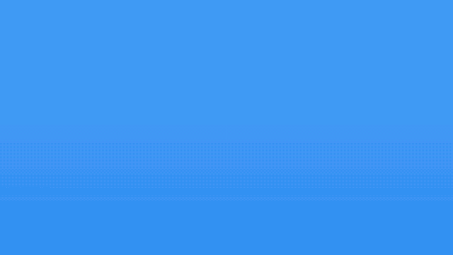

<h1 align="center">Desktop 1984</h1>

  

  <a href="https://www.youtube.com/watch?v=6VsyN4ilMFE">Полное демо-видео</a> · <a href="README.md">English version</a>

Анимированные обои для KDE Plasma 6. Камера под углом скользит над однобитным
рабочим столом, каждый пиксель которого — плитка, парящая над ровным градиентом.
Плитки вырастают на пустом фоне, вид плывёт вдоль окна или ряда значков, а затем
останавливается и остаётся обычными неподвижными обоями.

Анимация вдохновлена обоями «Macintosh» из macOS Sequoia. Вся графика здесь
оригинальная либо взята из свободных скриншотов KDE; подробности в разделе
[Лицензии](#лицензии).

## Сделано с помощью ИИ

Этот проект сделан с помощью ИИ. Код, шейдер, графику ретро-стола и эту
документацию написал Claude — ИИ-модель компании Anthropic — в Claude Code под
руководством автора, который ставил задачи, принимал решения по дизайну и
проверял результат на настоящем рабочем столе.

## Возможности

- **Четыре встроенные картинки**: ретро-рабочий стол, нарисованный для этих
  обоев, и скриншоты KDE 1.1 (1999), KDE 2.2 (2001) и KDE 3.5 (2005),
  переведённые в чёрно-белое.
- **Своя картинка**: любой файл PNG, JPEG, WebP, BMP, GIF или SVG. Он
  уменьшается и переводится в чёрно-белое на лету; яркость, контраст и
  дизеринг настраиваются.
- **Неподвижно или в движении**: по умолчанию картинка появляется, плавно
  останавливается и замирает, после чего ничего не тратит. Можно повторять
  появление раз в несколько минут или крутить без остановки, как заставку.
- **Цвета**: спектр, плавно проходящий все оттенки, пока картинка движется,
  либо один из семи фиксированных цветов.
- **Настраиваемый вид**: размер пикселя, зазор, непрозрачность пикселей,
  мягкость и сила теней, скорость и способ появления пикселей.
- **Лёгкая нагрузка на видеокарту**: всё рисует один фрагментный шейдер; когда
  картинка остановилась, ничего не перерисовывается.

## Требования

- KDE Plasma 6
- Qt 6.4 или новее

## Установка

### Из KDE Store

Страница в магазине: <https://www.opendesktop.org/p/2378213/>

Самый простой способ, ничего не нужно скачивать вручную:

1. Щёлкните правой кнопкой по рабочему столу и выберите **Настроить рабочий
   стол и обои**.
2. Нажмите **Загрузить новые модули…** рядом с типом обоев.
3. Найдите **Desktop 1984** и нажмите **Установить**.
4. Выберите тип обоев **Desktop 1984**.

Обновления приходят тем же путём: через этот диалог или Discover.

### Из репозитория

Пакет готов к установке прямо из репозитория:

    kpackagetool6 --type Plasma/Wallpaper --install package

или через `make` (заодно пересоберёт шейдер и картинки, см.
[Сборка](#сборка)):

    make install

Затем щёлкните правой кнопкой по рабочему столу, выберите **Настроить рабочий
стол и обои** и укажите тип обоев **Desktop 1984**.

После обновления уже установленной копии перезапустите оболочку, чтобы Plasma
загрузила новую версию:

    systemctl --user restart plasma-plasmashell

Удаление:

    kpackagetool6 --type Plasma/Wallpaper --remove org.dimap.desktop1984

## Настройки

Подписи в окне настроек на английском; ниже они приведены как есть.

### Картинка

| Настройка | Что делает |
|---|---|
| **Picture** | Одна из встроенных картинок или **Custom file…** — свой файл |
| **File** | Файл своей картинки |
| **Width in pixels** | До скольких пикселей по ширине уменьшается своя картинка; чем меньше, тем крупнее «зерно» |
| **Brightness**, **Contrast** | Яркость и контраст при переводе своей картинки в чёрно-белое |
| **Dither mid-tones** | Передавать серые тона узором из точек; без него — чистое чёрное и белое |
| **Swap black and white** | Инвертировать картинку; работает и для встроенных |

Плитками становятся только тёмные пиксели, поэтому лучше всего смотрятся
картинки со светлым фоном.

### Анимация и вид

| Настройка | Что делает |
|---|---|
| **Color** | **Spectrum** плавно проходит все оттенки; остальные цвета фиксированные |
| **Come to rest after appearing** | Включено: картинка появляется, тормозит и замирает. Выключено: сцены сменяют друг друга без конца |
| **Replay every** | Как часто замершая картинка уходит и показывается другая сцена |
| **Appearing** | От волны, проходящей по экрану, до одновременного роста всех пикселей |
| **Pixel size** | Размер одного пикселя на экране; **auto** — около 122 пикселей по ширине экрана |
| **Speed** | Скорость всей анимации |
| **Gap between pixels** | Зазор между соседними плитками |
| **Pixel opacity** | Насколько плитки темнее фона |
| **Shadow softness**, **Shadow strength** | Размытие и плотность тени под каждой плиткой |

## Подготовка картинки вручную

Обои сами конвертируют свои картинки, но `tools/convert.py` даёт более тонкое
управление и вдобавок подчёркивает контуры. Он записывает однобитный PNG,
который обои показывают без изменений:

    python3 tools/convert.py photo.jpg photo-1bit.png --width 480 --gamma 1.4

Список параметров — по `--help`. Для такого файла поставьте в **Width in
pixels** его ширину.

## Сборка

Для установки ничего собирать не нужно: сгенерированные файлы лежат в
`package/`. Чтобы менять шейдер или картинки, понадобятся:

- `qsb` из Qt Shader Tools — компиляция шейдера
- Python 3 с Pillow — рисование ретро-стола и конвертация скриншотов
- `qml` из Qt Declarative — предпросмотр и демо
- `ffmpeg` — демо-видео

| Команда | Что делает |
|---|---|
| `make build` | Компилирует шейдер и заново создаёт картинки |
| `make preview` | Показывает эффект в обычном окне, без Plasma |
| `make install` | Собирает и устанавливает либо обновляет обои для текущего пользователя |
| `make uninstall` | Удаляет их |
| `make demo` | Покадрово рендерит `demo/desktop1984-demo.mp4` и `demo/preview.gif` |
| `make screenshots` | Рендерит неподвижные кадры в `screenshots/` |
| `make dist` | Собирает `dist/desktop1984-<версия>.tar.gz` — архив для store.kde.org |

Структура:

| Путь | Содержимое |
|---|---|
| `package/` | Сами обои в том виде, в каком они устанавливаются |
| `package/contents/ui/PixelFlight.qml` | Анимация: сцены, камера, тайминги |
| `package/contents/shaders/pixels.frag` | Шейдер, рисующий плитки, тени и цвета |
| `package/contents/ui/pictures.js` | Встроенные картинки и маршруты камеры по ним |
| `tools/gen_art.py` | Рисует ретро-рабочий стол |
| `tools/convert.py` | Переводит картинку в однобитную |
| `tools/demo.qml` | Сценарий демо-видео |

## Лицензии

Desktop 1984 — свободное программное обеспечение под **GNU General Public
License версии 2 или (на ваш выбор) любой более поздней**. Полный текст — в
файле [`LICENSE`](LICENSE).

| Файлы | Происхождение | Лицензия |
|---|---|---|
| Исходный код, шейдер, сборочные скрипты | Написаны для этого проекта | GPL-2.0-or-later |
| `package/contents/images/world.png` | Оригинальная графика, рисуется скриптом `tools/gen_art.py` | GPL-2.0-or-later |
| `package/contents/images/kde1.png` | Однобитная версия [KDE 1.1.jpg](https://commons.wikimedia.org/wiki/File:KDE_1.1.jpg), скриншот команды разработчиков KDE | GPL |
| `package/contents/images/kde2.png` | Однобитная версия [KDE 2.2.2.png](https://commons.wikimedia.org/wiki/File:KDE_2.2.2.png), скриншот команды разработчиков KDE | GPL |
| `package/contents/images/kde3.png` | Однобитная версия [KDE 3.5 screenshot.png](https://commons.wikimedia.org/wiki/File:KDE_3.5_screenshot.png), скриншот Golradir | GPL |
| `tools/sources/*` | Те же скриншоты без изменений, с Wikimedia Commons | GPL |
| `tools/fonts/*.otb` | [Terminus Font](https://terminus-font.sourceforge.net/), автор Димитр Жеков | SIL Open Font License 1.1, см. `tools/fonts/OFL.txt` |
| `demo/*` | Записи этих обоев с перечисленными картинками | GPL-2.0-or-later |

Скриншоты KDE были сделаны резче и переведены в чёрно-белое упорядоченным
дизерингом; больше в них ничего не менялось. Terminus используется только для
текста на ретро-столе и в установленные обои не входит.

В заметке на ретро-столе приведена цитата Линуса Торвальдса.

Те же сведения идут вместе с установленным пакетом в файле
[`package/CREDITS.md`](package/CREDITS.md).

### Товарные знаки

KDE и логотип K Desktop Environment — товарные знаки KDE e.V. Macintosh и
macOS — товарные знаки Apple Inc. Это независимый проект: в нём нет графики,
шрифтов или кода Apple, и он не связан с Apple Inc. или KDE e.V. и не одобрен
ими.
